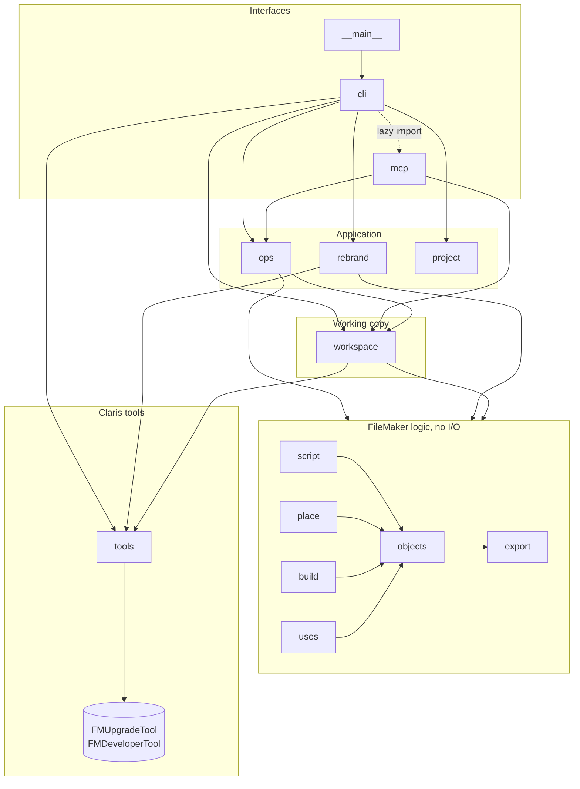
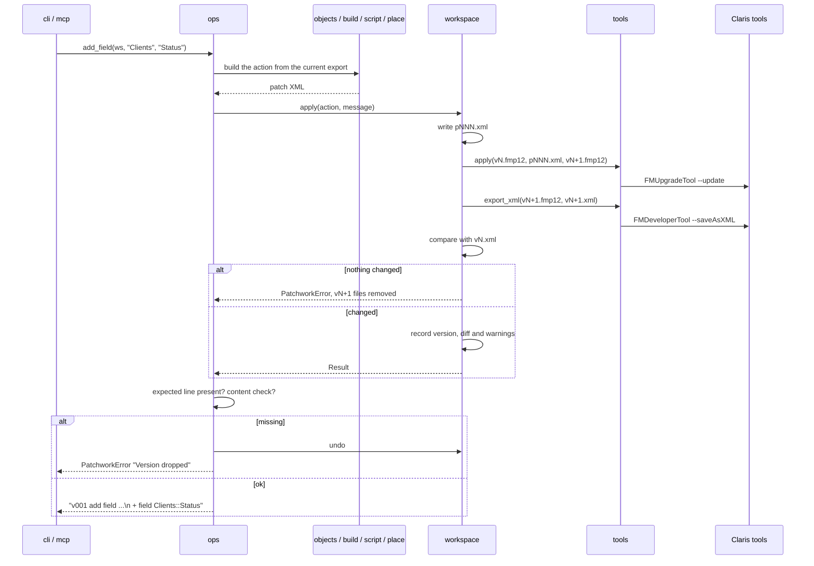

# Architecture

Patchwork is one Python package, `src/patchwork`, standard library only. Pillow is an optional extra for resizing images. It drives two Claris command-line tools, FMUpgradeTool and FMDeveloperTool, through `subprocess`.

## Layers



Arrows point from the importer to the imported module. `cli` and `mcp` also read two constants from the domain (`build.FIELD_TYPES`, `script.STEP_IDS`).

The rules are checked in CI by [import-linter](https://import-linter.readthedocs.io/), with the contracts in `pyproject.toml`:

1. `__main__` > `cli` > `mcp` > `ops` | `rebrand` | `project` > `workspace` > `tools`. A module never imports one above it, and the three application modules never import each other.
2. `export`, `objects`, `build`, `script`, `place` and `uses` import none of `tools`, `workspace`, `ops`, `rebrand`, `project`, `cli`, `mcp`.
3. `script` does not import `place`.

Run them locally:

```bash
pip install import-linter==2.16
PYTHONPATH=src lint-imports           # Windows: $env:PYTHONPATH = "src"; lint-imports
```

## Modules

| Module | Role |
|---|---|
| `__main__` | `python -m patchwork`: calls `cli.main` and exits with its code. |
| `cli` | The `patchwork` command (argparse). Prints what `ops` returns. `patchwork tool ...` calls `tools` directly, file to file. A `PatchworkError` is printed on one line and exits with code 1. |
| `mcp` | The MCP server: JSON-RPC 2.0, one message per line on stdin and stdout. Declares the 21 tools and their schemas, keeps the project folder, refuses `force` outside it. See [docs/mcp-tools.md](docs/mcp-tools.md). |
| `ops` | One function per command, shared by the CLI and MCP. Builds the patch, applies it through `workspace`, checks the expected change, and returns the text both interfaces print. |
| `rebrand` | `patchwork rebrand`: colors, fonts, logo and theme name from a `brand.json`, file to file in a temporary folder, without a workspace. |
| `project` | `patchwork init`: writes `AGENTS.md`, `CLAUDE.md`, the skills and the MCP configuration of four agents. Never overwrites a file. |
| `workspace` | The `.patchwork/` folder: `state.json`, `vNNN.fmp12`, `vNNN.xml`, `pNNN.xml`. Applies a patch as a new version, refuses it when the export did not change, records the diff, `undo`, `save`. |
| `tools` | The only module that runs a process. Finds the Claris tools, reads the password, builds the command lines, hides secrets in what it prints, stops a tool after `PATCHWORK_TOOL_TIMEOUT`. Also the path checks (`require_source`, `require_copy`, `require_new`, `require_root`). |
| `export` | Reads an `FMSaveAsXML` export: catalogs, themes, fields, table occurrences, XML escaping. |
| `objects` | The object kinds (layout, script, value list…): list, find, show, next free id, new UUIDs. Builds the add, replace and delete actions for scripts, value lists and custom functions. Computes the diff between two exports and the warning about steps that act outside the file. |
| `build` | Builds the other patch parts: fields, image calculations, theme and layout rewrites, color and font remapping, the `FMUpgradeToolPatch` wrapper. |
| `script` | Converts between `<Step>` XML and FileMaker script text, one step per line. 25 steps are built from text; a line left unchanged keeps its original XML. |
| `place` | Places a field on a layout next to an existing one: geometry, moving the objects below, growing the part. |
| `uses` | Finds what references an object, and where its name appears in calculations. |

`PatchworkError` (in `__init__.py`) is the error the user can fix. The CLI prints it without a traceback. MCP returns it as a tool result with `isError: true`.

## Main flows

### Open a file

`patchwork open SRC --account NAME`, or `patchwork_open`.

1. `tools.require_source` checks that the source is an existing `.fmp12`.
2. `FMUpgradeTool --generateGUIDs` writes `.patchwork/v000.fmp12`. The source is only read.
3. `FMDeveloperTool --saveAsXML` writes `v000.xml`.
4. `state.json` records the source, the account and version 0. If step 2 or 3 fails, `.patchwork/` is removed.

### One change



### `rebrand`

`rebrand.rebrand` works in a temporary folder: generate UUIDs, export, one patch for the logo field and the theme, export, one patch for the layouts that change, export, check that the theme was renamed and the logo is referenced, copy the result to the destination. The temporary folder is removed unless `--keep-work`.

### An MCP call

`mcp.serve` reads one line, `Server.handle` dispatches on `method`. `tools/call` runs `Server.call`, which locates the workspace and calls the tool's handler, usually one `ops` function. A `PatchworkError` becomes `isError: true`. Any other exception becomes JSON-RPC error `-32603`, so one bad call never stops the server.

## Files on disk

```
.patchwork/            created by open, next to the project
├── state.json         source, account, no_password, versions (n, message, time, changes)
├── v000.fmp12         the source with UUIDs
├── v000.xml           its export
├── pNNN.xml           the patch that made version NNN
├── vNNN.fmp12, vNNN.xml
└── .gitignore         "*"
```

## Decisions

The reasons behind these choices are in [docs/decisions/](docs/decisions/).
