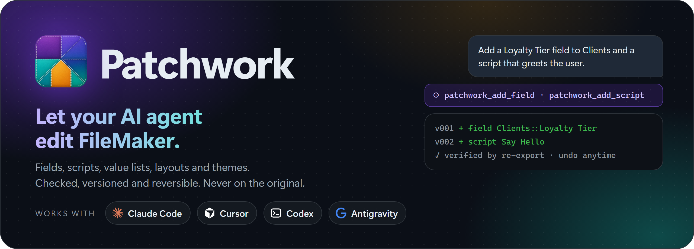
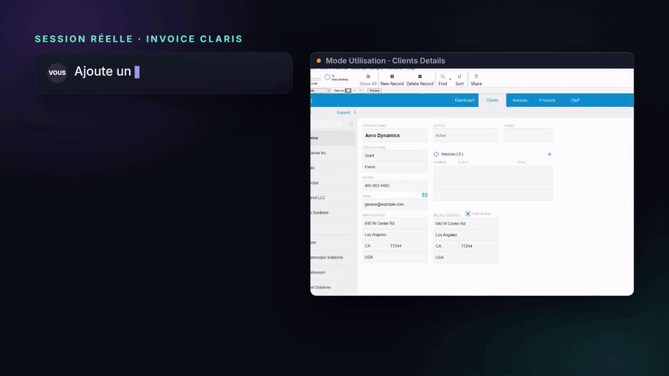
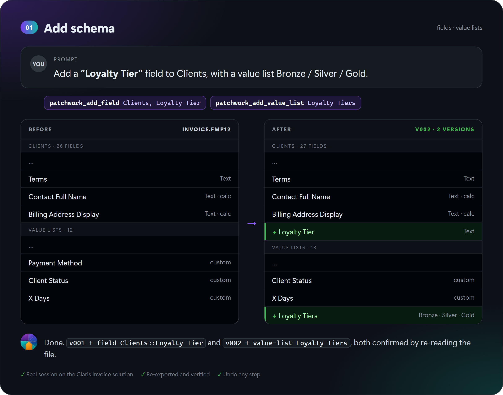
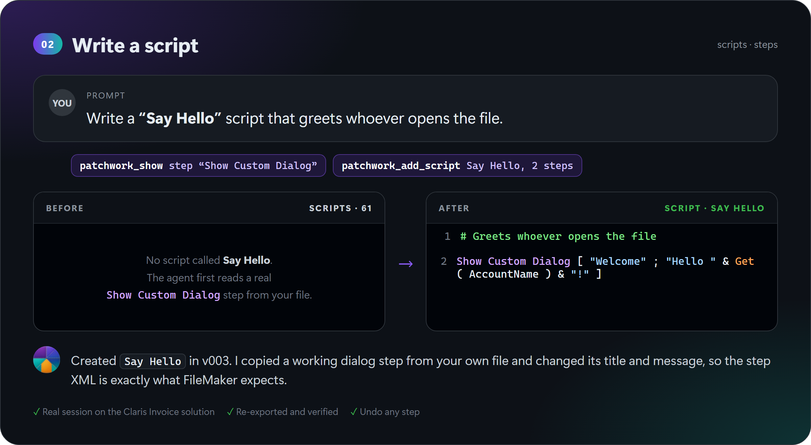
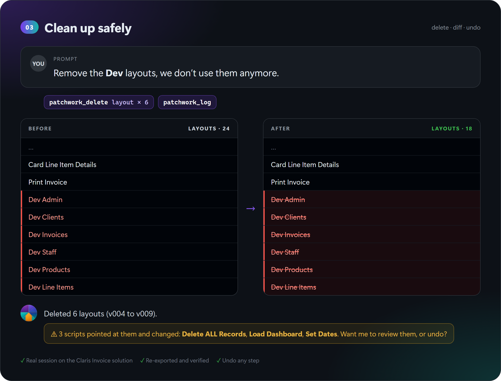
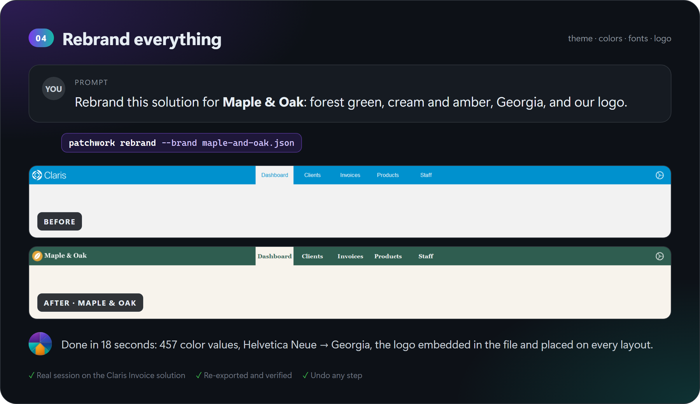

<div align="center">



<br>

[](https://github.com/Abdeltoto/patchwork-filemaker-mcp/actions/workflows/ci.yml)
[](https://github.com/Abdeltoto/patchwork-filemaker-mcp/stargazers)
[](https://github.com/Abdeltoto/patchwork-filemaker-mcp/blob/main/LICENSE)


[](https://github.com/Abdeltoto/patchwork-filemaker-mcp/blob/main/CONTRIBUTING.md)

<a href="#brancher-votre-agent"></a>
<a href="#brancher-votre-agent"></a>
<a href="#brancher-votre-agent"></a>
<a href="#brancher-votre-agent"></a>

**[Démarrage](#démarrage)** · **[Exemples](#en-action)** · **[Brancher votre agent](#brancher-votre-agent)** · **[Ce qu'il peut modifier](#ce-quil-peut-modifier)** · **[Guide de terrain](https://github.com/Abdeltoto/patchwork-filemaker-mcp/blob/main/docs/fmupgradetool-field-guide.md)** · **[English](https://github.com/Abdeltoto/patchwork-filemaker-mcp/blob/main/README.md)**

<br>



</div>

<br>

> **Vendredi, 16 h. Un client demande « juste un petit champ de plus » sur le modèle de détail.**
> Vous connaissez la suite : définir la rubrique, copier l'étiquette, décaler chaque objet en dessous, agrandir la partie… puis tout recommencer sur le modèle suivant.
>
> **Patchwork confie ces clics à votre agent IA.** Demandez simplement, avec vos mots, comme vous le demanderiez à un collègue. Votre agent ajoute la rubrique et la place exactement où vous l'avez dit, écrit des scripts, crée des listes de valeurs et refait le style des modèles, dans un vrai fichier `.fmp12`. Chaque modification est vérifiée, chaque modification peut être annulée, et votre fichier d'origine n'est jamais touché.

Gratuit et open source. Fonctionne avec Claude Code, Cursor, Codex et Antigravity.

<p align="center"><a href="https://youtu.be/g5UkJLiYAhA"></a><br><sub>▶ <a href="https://youtu.be/g5UkJLiYAhA">Regarder la présentation en 90 secondes sur YouTube</a> · <a href="https://youtu.be/AkFhBpB0YYY">English version</a></sub></p>

## Prérequis

- Python 3.10 ou plus récent, sous Windows, macOS ou Linux.
- Les outils en ligne de commande Claris FMUpgradeTool et FMDeveloperTool. Ils sont fournis avec l'installeur de FileMaker Server (la version d'essai gratuite suffit), et aucun serveur n'a besoin de tourner : [installer les outils Claris](https://github.com/Abdeltoto/patchwork-filemaker-mcp/blob/main/docs/install-fmupgradetool.md). Vérifié avec FileMaker 2026 (26.0.3).
- Un `.fmp12` fermé et un compte avec accès intégral.

## Démarrage

Trois commandes, et ensuite vous parlez simplement à votre agent.

```bash
pip install filemaker-patchwork
patchwork doctor          # trouve les outils en ligne de commande Claris
patchwork init .          # branche ce dossier pour Claude Code, Cursor, Codex et Antigravity
```

Sans installation, avec [uv](https://docs.astral.sh/uv/) : `uvx filemaker-patchwork doctor`, et `uvx filemaker-patchwork mcp` comme commande du serveur MCP.

Puis demandez à votre agent : *« Ouvre Invoice.fmp12 et ajoute une rubrique Status dans Clients. »* C'est tout.

### Bon à savoir

- **Il modifie la structure, pas les enregistrements.** Rubriques, scripts, modèles, listes de valeurs, thèmes. Pour vos données, utilisez la Data API ou OData.
- **Il travaille sur des fichiers fermés, pas sur des fichiers hébergés.** Modifiez une copie, testez-la, puis déployez-la comme d'habitude.
- **Il a besoin des outils en ligne de commande Claris** (FMUpgradeTool et FMDeveloperTool). Ils sont fournis avec l'installeur de FileMaker Server, la version d'essai gratuite suffit et aucun serveur n'a besoin de tourner : [installer les outils Claris](https://github.com/Abdeltoto/patchwork-filemaker-mcp/blob/main/docs/install-fmupgradetool.md). Patchwork lui-même n'a aucune autre dépendance.

## En action

Quatre vraies sessions sur la solution gratuite [Claris Invoice](https://marketplace.claris.com/detail/2000.html). Pour chacune : la demande, ce que l'agent a fait, et le fichier avant et après. Aucune maquette.

<p align="center"></p>

<p align="center"></p>

<p align="center"></p>

<p align="center"></p>

## Comment ça marche

<p align="center"></p>

Pourquoi votre agent ne peut-il pas le faire seul ? Un fichier FileMaker est un fichier binaire, et sa structure se cache derrière des fenêtres qu'un agent ne peut pas cliquer. Claris fournit bien une porte d'entrée en ligne de commande, [FMUpgradeTool](https://help.claris.com/en/app-upgrade-tool-guide/content/index.html), mais elle est exigeante : chaque objet est désigné par un UUID, et un patch légèrement faux est **ignoré en silence**, alors que l'outil affiche quand même `Patch File Applied`.

Patchwork est l'assistant minutieux entre les deux :

| | |
|:-:|---|
| 🧵 **Écrit le patch** | Lit l'export XML du fichier et construit un patch avec les bons UUID, identifiants et catalogues, pour que votre agent n'ait pas à le faire |
| 🔍 **Vérifie le résultat** | Réexporte le fichier après chaque modification et le compare à la version précédente. Si FileMaker a ignoré quelque chose, la modification est refusée au lieu d'être perdue en silence |
| 🧭 **Prévient avant de casser** | Avant une suppression, liste les scripts, modèles et calculs qui utilisent l'objet, et attend votre feu vert |
| 🕐 **Garde chaque version** | Chaque modification est une version numérotée avec son diff. Vous changez d'avis ? `undo` fonctionne toujours |
| 🔒 **Protège l'original** | Tout se passe sur une copie de travail. `save` écrit un nouveau fichier et n'écrase jamais le vôtre |

Plus de détails dans [comment ça marche](https://github.com/Abdeltoto/patchwork-filemaker-mcp/blob/main/docs/how-it-works.md).

## Brancher votre agent

Une seule commande prépare tout. Lancez `patchwork init .` dans le dossier de votre projet, nouveau ou existant : elle ajoute les règles, les skills et la configuration MCP de chaque agent, et conserve les fichiers déjà présents.

| Agent | Configuration écrite par `init` | Ensuite |
|---|---|---|
|  **Claude Code** | `.mcp.json` · `CLAUDE.md` · `.claude/skills/` | Lancez `claude` dans le dossier et acceptez `patchwork` |
|  **Cursor** | `.cursor/mcp.json` · `.cursor/skills/` | Activez `patchwork` dans Settings › MCP |
| ⌨️ **Codex** | `.codex/config.toml` · `AGENTS.md` · `.agents/skills/` | Faites confiance au projet quand Codex le demande |
|  **Antigravity** | `.agents/mcp_config.json` · `AGENTS.md` · `.agents/skills/` | Ouvrez le dossier comme espace de travail |

Chaque agent reçoit les mêmes 21 outils via `patchwork mcp`, un serveur MCP stdio. Le mot de passe de votre fichier reste à vous : définissez-le une fois dans votre terminal avec `PATCHWORK_PASSWORD`, et les agents ne le voient jamais. Configuration manuelle : [agents IA](https://github.com/Abdeltoto/patchwork-filemaker-mcp/blob/main/docs/ai-agents.md). Chaque outil, ses paramètres, ses réponses et ses erreurs : [référence des outils MCP](https://github.com/Abdeltoto/patchwork-filemaker-mcp/blob/main/docs/mcp-tools.md) (en anglais).

## Ce qu'il peut modifier

Des rubriques, des scripts en texte brut, des listes de valeurs, les couleurs et les polices, et même une refonte graphique complète. Chaque opération ci-dessous a été essayée sur de vrais fichiers et confirmée par un nouvel export.

| | Ajouter | Modifier | Supprimer |
|---|:-:|:-:|:-:|
| **Rubriques** · texte, nombre, date, heure, horodatage, conteneur, calcul, globale | ✅ | | ✅ |
| **Scripts**, lus et écrits en texte FileMaker | ✅ | ✅ | ✅ |
| **Listes de valeurs** | ✅ | ✅ | ✅ |
| **Fonctions personnalisées** | ✅ | ✅ | ✅ |
| **Modèles** · placer une rubrique avec son étiquette, modèle entier, couleurs, polices, remplacer une rubrique | ✅ rubrique | ✅ | ✅ |
| **Thèmes** · couleurs, polices, nom | | ✅ | |
| **Tables**, occurrences de table | 👁 lecture | | |

> [!TIP]
> Les scripts se lisent et s'écrivent comme dans l'espace de travail des scripts, un pas par ligne :
> `Set Field [ Clients::Status ; "Gold" ]`. Modifiez le texte de `patchwork show script NOM` et renvoyez-le avec `set-steps` : les lignes inchangées gardent leur pas exact, et chaque pas est relu après la modification, donc un paramètre perdu est détecté.

Ce que FMUpgradeTool ne sait pas faire (les données des enregistrements, un thème entièrement nouveau, un objet de modèle seul) est listé dans [le guide de terrain](https://github.com/Abdeltoto/patchwork-filemaker-mcp/blob/main/docs/fmupgradetool-field-guide.md).

## Sans agent

Vous préférez le terminal ? Tout ce que fait l'agent est une commande ordinaire, que vous pouvez lancer vous-même :

```bash
export PATCHWORK_PASSWORD='...'                     # Windows : $env:PATCHWORK_PASSWORD = '...'
patchwork open "Invoice.fmp12" --account Admin     # copie de travail, version v000 (--no-password si le compte n'en a pas)
patchwork add-field Clients "Loyalty Tier"
patchwork add-value-list "Loyalty Tiers" Bronze Silver Gold
patchwork log                                       # chaque version et ce qui a changé
patchwork undo
patchwork save "Invoice v2.fmp12"
```

<details>
<summary><b>Toutes les commandes</b></summary>

<br>

| Commande | Rôle |
|---|---|
| `open SRC --account NOM` | Crée une copie de travail dans `.patchwork/` (version v000). La source n'est jamais modifiée |
| `status`, `log` | Version courante, et chaque version avec ce qui a changé |
| `ls [TYPE] [TABLE]` | Liste les modèles, scripts, listes de valeurs, fonctions, thèmes, tables, rubriques |
| `show TYPE NOM` | Affiche un script en texte FileMaker (`--xml` pour le XML), le reste en XML. `show step NOM` affiche un vrai exemple de pas |
| `palette [--theme NOM]` | Couleurs utilisées par un thème, des plus fréquentes aux moins fréquentes |
| `add-field TABLE NOM` | Ajoute une rubrique : `--type`, `--calc`, `--global`, `--image logo.png` |
| `add-value-list NOM VALEURS...` | Ajoute une liste de valeurs personnalisée |
| `add-custom-function NOM --calc` | Ajoute une fonction personnalisée, avec `--param` |
| `add-script NOM PAS.txt` | Crée un script à partir de texte FileMaker (ou de XML `<Step>`) |
| `set-steps`, `append-steps` | Réécrit un script avec le texte de `show` modifié, ou ajoute des pas à la fin |
| `place-field MODÈLE TO::RUBRIQUE --near RUBRIQUE` | Place une rubrique sous une autre, avec une copie de son apparence et de son étiquette. `--side right`, `--label` |
| `add TYPE FICHIER.xml` | Ajoute une liste de valeurs ou une fonction personnalisée depuis du XML |
| `replace TYPE NOM FICHIER.xml` | Remplace un objet par votre version modifiée de `show` |
| `uses TYPE NOM` | Liste ce qui référence un objet, et où son nom apparaît dans les calculs |
| `delete TYPE NOM` | Supprime un script, un modèle, une liste, une fonction ou une rubrique. Refusé tant que d'autres objets l'utilisent, sauf avec `--force` |
| `retheme`, `recolor-layouts` | Réécrit couleurs et polices d'un thème, ou des styles locaux des modèles |
| `push PATCH.xml` | Applique un patch FMUpgradeTool écrit à la main, avec les mêmes vérifications |
| `undo` | Retire la dernière version |
| `save DEST` | Écrit la version courante dans un nouveau `.fmp12` |
| `rebrand SRC DEST --brand brand.json` | En une fois : couleurs, polices, logo et nom du thème sur toute une solution |
| `mcp` | Le serveur MCP pour les agents |
| `init DOSSIER` | Branche un dossier pour Claude Code, Cursor, Codex et Antigravity |
| `doctor` | Montre quels outils Claris Patchwork a trouvés. Code de sortie 2 s'il en manque un |
| `tool guids\|export\|validate\|apply\|new-file` | Lance un outil Claris directement, de fichier à fichier, avec les mêmes contrôles de chemins |

Chaque commande de modification accepte `-m "note"` pour le journal et `--dry-run` pour écrire le patch sans l'appliquer. `-C DOSSIER`, avant la commande, choisit le dossier du projet : `patchwork -C ~/crm status`. Sans lui, Patchwork prend `PATCHWORK_PROJECT`, puis le `.patchwork/` le plus proche en remontant depuis le dossier courant. Seule exception, `open` crée `.patchwork/` dans le dossier de `-C`, sinon dans le dossier courant. `patchwork COMMANDE --help` liste toutes les options. Plus d'exemples dans [exemples et recettes](https://github.com/Abdeltoto/patchwork-filemaker-mcp/tree/main/examples).

</details>

## Variables d'environnement

Patchwork les lit dans l'environnement. Il ne charge jamais de fichier `.env` : définissez-les dans votre terminal ou dans le bloc `env` de votre client MCP. [`.env.example`](https://github.com/Abdeltoto/patchwork-filemaker-mcp/blob/main/.env.example) les liste.

| Variable | Rôle |
|---|---|
| `PATCHWORK_PASSWORD` | Mot de passe du compte donné à `open`. Obligatoire sauf avec `--no-password`. Jamais affiché |
| `PATCHWORK_KEY` | Clé de chiffrement, pour les fichiers chiffrés. Transmise à FMUpgradeTool quand un patch est validé ou appliqué, pas lors de la copie ni de l'export. Jamais affichée. Une session complète sur un fichier chiffré est à confirmer |
| `PATCHWORK_PROJECT` | Dossier du projet qui contient `.patchwork/`, quand `-C` n'est pas donné. Ignoré par `open` |
| `FM_UPGRADE_TOOL`, `FM_DEVELOPER_TOOL` | Chemins des outils Claris, quand `doctor` ne les trouve pas |
| `PATCHWORK_ALLOW_OUTSIDE` | `1` permet aux outils MCP d'utiliser `force` hors du dossier du projet. Absent de la version 0.1.0 |
| `PATCHWORK_TOOL_TIMEOUT` | Secondes avant l'arrêt d'un outil Claris qui ne répond pas. 1800 par défaut. Absent de la version 0.1.0 |
| `PATCHWORK_SAMPLE` | Tests seulement : une copie de la solution Claris Invoice pour les tests de bout en bout |

## Lancer depuis les sources et tester

```bash
git clone https://github.com/Abdeltoto/patchwork-filemaker-mcp
cd patchwork-filemaker-mcp
python -m venv .venv
. .venv/bin/activate                 # Windows PowerShell : .venv\Scripts\Activate.ps1
pip install -e ".[image]"
python -m unittest discover -s tests
```

Les tests unitaires n'ont besoin ni de FileMaker ni des outils Claris. Les tests de bout en bout, le lint et la couverture sont décrits dans [CONTRIBUTING.md](https://github.com/Abdeltoto/patchwork-filemaker-mcp/blob/main/CONTRIBUTING.md) (en anglais).

## Organisation du dépôt

```
src/patchwork/        le paquet : CLI, serveur MCP, logique FileMaker
  skills/, templates/ ce que `patchwork init` copie dans un projet
tests/                tests unitaires, fixtures/ (exports fictifs), test_integration.py (vrais fichiers)
docs/                 guides, référence des outils MCP, decisions/
examples/             recettes et la marque Maple & Oak
scripts/              extract-fms-tools.ps1 (outils Claris depuis le .msi, Windows)
brand.schema.json     schéma JSON de brand.json
server.json           fiche pour le registre MCP
```

Comment les modules s'articulent : [ARCHITECTURE.md](https://github.com/Abdeltoto/patchwork-filemaker-mcp/blob/main/ARCHITECTURE.md) (en anglais).

## Le guide de terrain FMUpgradeTool

Le [guide de terrain](https://github.com/Abdeltoto/patchwork-filemaker-mcp/blob/main/docs/fmupgradetool-field-guide.md) rassemble tous les pièges que FMUpgradeTool tend sans prévenir, découverts à la dure sur de vrais fichiers. Utile même si vous n'utilisez jamais Patchwork. Un aperçu :

- sans `--generateGUIDs`, les patchs de thème et de rubrique sont ignorés ;
- l'UUID d'un modèle n'est **pas** le premier `<UUID>` qu'il contient ;
- remplacer un seul objet de modèle est ignoré, remplacer le modèle entier fonctionne ;
- supprimer un pas de script demande un `ScriptReference` dans chaque `ScriptStepReference`.

Vous en avez trouvé un autre ? [Ajoutez-le](https://github.com/Abdeltoto/patchwork-filemaker-mcp/issues/new?template=field-guide.yml).

## FAQ

<details>
<summary><b>Est-ce que ça marche sur des fichiers hébergés ?</b></summary>
<br>
Patchwork travaille sur des fichiers <code>.fmp12</code> fermés, sur disque. Prenez une copie du fichier hébergé, modifiez-la, testez-la, puis déployez-la comme d'habitude, ou transférez les données avec le Claris Data Migration Tool.
</details>

<details>
<summary><b>L'agent peut-il modifier les enregistrements ?</b></summary>
<br>
Non, FMUpgradeTool ne change que la structure. Pour les enregistrements, utilisez la Data API ou OData. Le skill <code>fm-data</code> explique comment.
</details>

<details>
<summary><b>Quelles versions de FileMaker ?</b></summary>
<br>
Développé et vérifié avec FileMaker 2026 (26.0.3). Les versions antérieures qui fournissent FMUpgradeTool et <code>FMDeveloperTool --saveAsXML</code> devraient fonctionner mais n'ont pas été testées. Un retour, positif ou non, est le bienvenu.
</details>

<details>
<summary><b>macOS et Linux ?</b></summary>
<br>
Partout où les outils Claris tournent. La CI tourne sous Windows, macOS et Linux.
</details>

<details>
<summary><b>Mon mot de passe est-il en sécurité avec un agent ?</b></summary>
<br>
Oui. Il est lu dans la variable d'environnement <code>PATCHWORK_PASSWORD</code>, transmis aux outils Claris et affiché <code>***</code>. Il n'est jamais écrit dans un fichier de configuration ni montré à l'agent.
</details>

## Contribuer

Un nouveau piège FMUpgradeTool, une recette, une opération qui vous manque ? Tout est bienvenu : commencez par [CONTRIBUTING.md](https://github.com/Abdeltoto/patchwork-filemaker-mcp/blob/main/CONTRIBUTING.md). Et si Patchwork vous rend votre vendredi après-midi, une ⭐ aide d'autres développeurs FileMaker à le trouver.

<a href="https://star-history.com/#Abdeltoto/patchwork-filemaker-mcp&Date">
  
</a>

## Licence

[MIT](https://github.com/Abdeltoto/patchwork-filemaker-mcp/blob/main/LICENSE). Patchwork est un projet communautaire, sans lien avec Claris International Inc. ni soutien de sa part. FileMaker et Claris sont des marques de Claris International Inc. Les autres noms de produits et logos appartiennent à leurs propriétaires.
