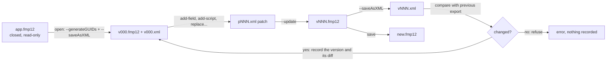

# How Patchwork works

FileMaker files are binary. Claris gives two command-line tools that make them scriptable:

- `FMDeveloperTool --saveAsXML` writes the whole structure of a file as XML (an **export**, root `FMSaveAsXML`).
- `FMUpgradeTool --update` applies a **patch** (root `FMUpgradeToolPatch`) to a file and writes the result to a new file.

A patch addresses every object by UUID. Writing one by hand means copying UUIDs, ids and whole XML blocks out of a 2 MB export, and FMUpgradeTool silently skips anything slightly wrong. Patchwork reads the export, writes the patch, and checks that it worked.

## The working copy



`patchwork open` creates `.patchwork/` next to your project:

```
.patchwork/
├── state.json      source, account, every version with its message, time and diff
├── v000.fmp12      the source with a UUID on every object
├── v000.xml        its export
├── p001.xml        the patch that made v001
├── v001.fmp12
├── v001.xml
└── .gitignore      "*": nothing here is ever committed
```

## One change

1. **Read.** Every identifier comes from the current export: the object's own UUID, the next free id in its catalog, the base table a field belongs to, the patch `version` attribute.
2. **Write the patch.** Each operation knows the exact shape FMUpgradeTool accepts. For example, a deleted field is an `ItemReference type="FieldReference"` with its `BaseTableReference` inside, and a script with steps is one `AddAction` holding both the `ScriptCatalog` entry and its `StepsForScripts`.
3. **Apply** the patch to the current version, writing the next one.
4. **Export** the result.
5. **Compare.** Patchwork removes the parts of the export that change on every save (the header and the UUID bookkeeping: modification counts, user names, timestamps) and compares the rest with the previous version:
   - identical: FMUpgradeTool skipped the patch. The version is refused and the patch is kept for inspection;
   - different: Patchwork lists what was added, changed and deleted, by kind and name. If the operation expected a specific line, such as `+ field Clients::Status`, and it is missing, the version is rolled back.

When a version adds steps that act outside the file (Send Event, Perform AppleScript, Perform JavaScript in Web Viewer, Insert from URL, Open URL, Send Mail, Install Plug-In File), the diff ends with a line such as `! 1 new Insert from URL step(s): they run when the file is used, check them before opening it`. Not in release 0.1.0.

Each Claris tool is stopped after `PATCHWORK_TOOL_TIMEOUT` seconds (default 1800) if it does not answer, and the change is refused. Not in release 0.1.0.

The diff often shows more than the object you touched. Deleting a layout, for example, also reports `~ script Delete ALL Records` when that script navigates to it. That is the moment to check the script.

## FMUpgradeTool changes UUIDs

FMUpgradeTool gives new UUIDs to what it adds, and to the objects inside a replaced layout. A patch built from an older export points at UUIDs that no longer exist and is skipped. Because Patchwork always builds from the latest export, this never happens in a session. It is also why `undo` simply goes back to the previous `.fmp12` and its export.

## `rebrand`

`rebrand` runs the same cycle on its own, file to file: generate UUIDs, export, add the logo field and rewrite the theme, export, rewrite the layouts that use the old logo or the old colors, export, check that the theme was renamed and the logo is referenced, then copy the result to the destination.
